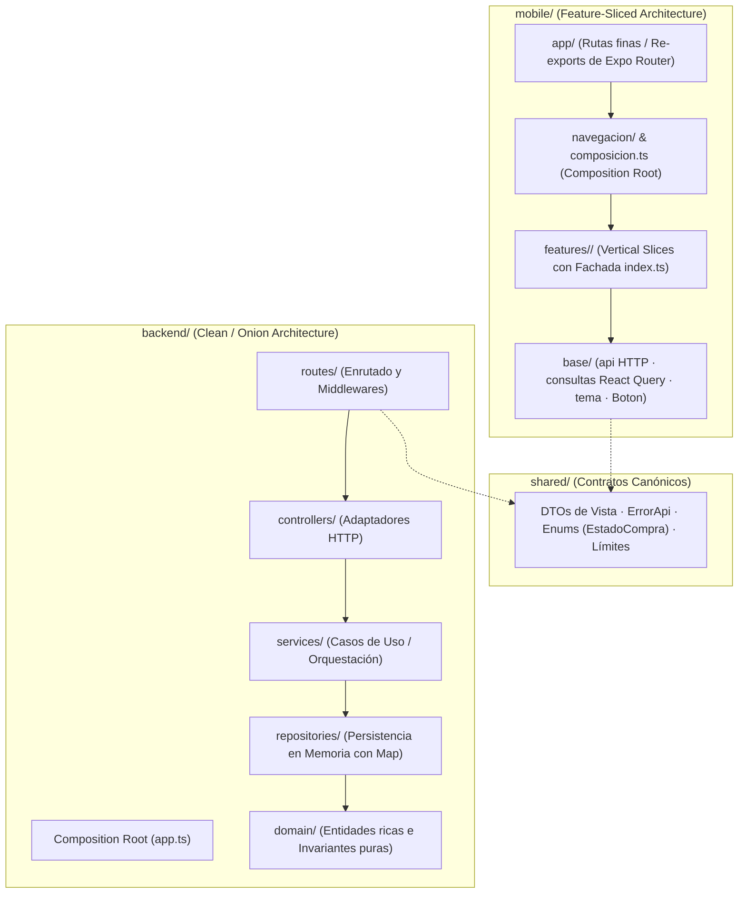

<p align="center"></p>

# AI Ticket It

Plataforma móvil para publicar eventos y vender entradas. Trabajo Práctico Individual de
Desarrollo con IA — Diseño de Sistemas, UTN FRBA, 2C 2026.

## Cómo se trabaja

El proyecto se desarrolla con **Spec-Driven Development** usando
[Spec Kit](https://github.com/github/spec-kit) y Claude Code:

1. **Constitución** — principios y reglas del dominio: [`.specify/memory/constitution.md`](.specify/memory/constitution.md)
2. **Backlog** — features priorizadas y sus dependencias: [`docs/backlog.md`](docs/backlog.md)
3. **Por feature**: `specify → clarify → plan → tasks → implement`, en su rama
   `feature/NNN-slug`, integrada a `development` por Pull Request. Los artefactos de cada
   feature quedan en `specs/NNN-slug/`.

Consigna y casos de uso: [`docs/consigna/consigna.md`](docs/consigna/consigna.md).

## Stack

| Capa | Tecnología |
|---|---|
| Backend | Node + Express 5 + TypeScript, en capas (routes → controllers → services → repositories → domain) |
| Persistencia | En memoria: repositorios con `Map`, sin base de datos (lo pide la consigna) |
| Mobile | React Native con Expo + Expo Router |
| Tests | Vitest + supertest · Jest + React Native Testing Library |

## Arquitectura del Sistema

El proyecto adopta un enfoque desacoplado en **Monorepo**, con contratos compartidos y patrones arquitectónicos específicos para cada plataforma:



### 1. Backend: Capas Limpias con Dominio Rico (DDD táctico)
- **Separación estricta de responsabilidades**: Las dependencias apuntan siempre hacia adentro (`routes → controllers → services → repositories → domain`).
- **Dominio Puro**: Las entidades (`Evento`, `Compra`, `TipoEntrada`) son clases inmutables que encapsulan reglas de negocio e invariantes, totalmente aisladas de Express y de operaciones de entrada/salida.
- **Inversión de Dependencias (DIP)**: Los servicios dependen de contratos abstractos de repositorio (`domain/repositorios.ts`), permitiendo que la persistencia en memoria sea un detalle de infraestructura reemplazable.
- **Atomicidad y Concurrencia**: Control de concurrencia mediante cerrojos por agregado (`cerrojo-por-clave.ts`) y tramos síncronos sin `await` para garantizar la consistencia en el decremento de cupos.

### 2. Mobile: Feature-Sliced Architecture & Thin Client
- **Organización por Features (Vertical Slices)**: Cada funcionalidad de negocio (`usuarios`, `sesion`, `eventos`, `compras`) vive en su propio módulo encapsulado bajo `src/features/<dominio>/`.
- **Patrón Fachada (Facade)**: Cada feature expone únicamente un `index.ts` público; la base y otras features no pueden importar archivos internos, regla auditada automáticamente por el linter (`eslint-plugin-import-x`).
- **Validación Server-Driven**: La app no duplica la lógica de negocio del backend en servicios locales. La interfaz restringe la entrada de forma natural y el servidor actúa como única fuente de verdad, mapeando los errores de API (`ErrorDeApi` con `detalles`) directamente en los campos del formulario.
- **Rutas Delgadas**: La capa de navegación (`mobile/app/`) no maneja estado, estilos ni lógica; solo re-exporta las pantallas de cada feature.

### 3. Contrato Compartido (`shared/`)
- Fuente única de verdad tipada para DTOs (`UsuarioVista`, `ErrorApi`), enumeraciones (`EstadoCompra`) y reglas globales (`LIMITES_COMPRA`), asegurando simetría estricta en tiempo de compilación entre frontend y backend.

## Para arrancar (backend)

### Requisitos previos

- **Node ≥ 22.12** y **npm ≥ 10** (`node -v`, `npm -v`).
- No hace falta instalar ninguna base de datos: los datos viven en memoria.

### Instalar y arrancar

```bash
npm install
npm start        # o npm run dev para recargar ante cambios
```

El servidor guarda sus datos **en memoria** y arranca siempre con los datos de ejemplo
(5 usuarios, 6 categorías y 8 eventos, con ids legibles como `usuario-lucia` o
`evento-noche-de-rock`). Todo lo que se cree se pierde al detenerlo, y cada arranque vuelve a
los mismos datos. La salida muestra las direcciones:

```text
AI Ticket It API escuchando
  Local: http://localhost:3000/api
  Red:   http://192.168.0.23:3000/api (Wi-Fi)
Datos de ejemplo cargados en memoria (se pierden al detener el servidor)
```

Probalo con `curl http://localhost:3000/api/salud`. La documentación navegable de la API
(Swagger) está en **http://localhost:3000/api/docs**; para Postman, importá
`backend/src/docs/ai-ticket-it.postman_collection.json` o la especificación
`http://localhost:3000/api/docs/openapi.json`. El contrato y el formato de errores están en
[`specs/001-base-backend/contracts/api.md`](specs/001-base-backend/contracts/api.md).

### Consultar desde otro dispositivo (el celular con la app)

1. PC y celular en la **misma red Wi-Fi**.
2. Usá la dirección `Red` que imprime `npm start` (por ejemplo,
   `http://192.168.0.23:3000/api/salud`).
3. Abrí la dirección en **Firefox**, escribiéndola completa con `http://`. Chrome y Samsung
   Internet la cambian solos a `https://` (modo "usar siempre conexiones seguras") y fallan
   sin avisar, porque el servidor local no tiene HTTPS.
4. Si cambiás de red (por ejemplo, al hotspot del celular), reiniciá el servidor: las
   direcciones `Red` se calculan al arrancar.
5. Si desde la PC responde y desde el celular no, en Windows:
   - Abrí **Seguridad de Windows → Firewall y protección de red → Permitir una aplicación a
     través del firewall**.
   - Tocá **Cambiar la configuración**, buscá **Node.js JavaScript Runtime** (o
     **Permitir otra aplicación…** y elegí `node.exe`) y marcá **Privada**.
   - En **Configuración → Red e Internet → Wi-Fi → (tu red)**, verificá que el perfil sea
     **Red privada**.
   - Si la PC tiene adaptadores virtuales (VirtualBox, WSL, VPN), imprime varias direcciones
     `Red`, cada una con el nombre de su interfaz entre paréntesis: usá la de `(Wi-Fi)`.
   - En redes institucionales (facultad, trabajo) suele estar bloqueada la comunicación entre
     dispositivos. Si el celular no llega aunque el firewall esté bien, compartí internet
     desde el celular, conectá la PC a ese hotspot y usá la nueva dirección `Red`.

## Para arrancar (app móvil)

### Requisitos previos

- El backend andando (sección anterior) y `npm install` hecho desde la raíz: instala también
  `mobile/`.
- Un celular Android (o iOS) con **Expo Go** de la tienda. La app usa el **SDK 58 de Expo**
  (validado con Expo Go para Android 58.0.5). Expo Go abre solo proyectos del SDK que soporta:
  verificalo en Expo Go → Ajustes ("Supported SDK"). Con otro SDK la app no abre.
- PC y celular en la **misma red Wi-Fi**.

### Arrancar y abrir en el celular

```bash
npm start          # terminal 1: el servidor; anotá la IP de la línea "Red:"
npm run mobile     # terminal 2: Metro (expo start) muestra un QR
```

Escaneá el QR con Expo Go (Android) o con la cámara (iOS). La primera vez aparece
"¿Con quién querés operar?" con los usuarios de ejemplo: elegí uno y entrás a las pestañas
Explorar · Mis compras · Mis eventos · Perfil. La app recuerda al usuario elegido; para cambiarlo,
Perfil → "Cambiar usuario".

### Dirección del servidor

Por defecto la app le habla al servidor en la misma IP desde la que Expo sirve la app (la de la
PC), puerto 3000: `http://<IP de la PC>:3000/api`. Si hace falta otra, copiá
`mobile/.env.example` a `mobile/.env` (no se versiona) y poné la dirección **con `/api`**:

```bash
EXPO_PUBLIC_API_URL=http://192.168.0.23:3000/api
```

Después de crear, cambiar o borrar `mobile/.env`, arrancá con `npm run mobile -- --clear`:
Metro guarda las variables en caché y sin `--clear` sigue usando las anteriores.

No uses `localhost`: en el celular, `localhost` es el propio celular, no la PC. La dirección que
usa la app se ve en la franja "Servidor no disponible" y en el selector cuando no llega.

### Si el QR o la app apuntan a otra IP (VirtualBox, WSL, VPN)

Si la PC tiene adaptadores virtuales, Expo puede anunciar la IP de uno de ellos (por ejemplo,
`192.168.56.1` de VirtualBox Host-Only): el QR y la dirección del servidor quedan apuntando ahí
y el celular no llega. Detené Expo y arrancalo con la IP de la Wi-Fi (la línea `Red: … (Wi-Fi)`
de `npm start`):

```powershell
$env:REACT_NATIVE_PACKAGER_HOSTNAME="192.168.0.23"; npm run mobile   # PowerShell
```

```bash
REACT_NATIVE_PACKAGER_HOSTNAME=192.168.0.23 npm run mobile           # bash
```

### Diagnóstico de "Servidor no disponible"

La app muestra una franja "Servidor no disponible · <dirección>" (o el selector, el mismo
aviso con "Reintentar") cuando no llega al servidor. Reintenta sola (1, 2, 4, 8, 16 y 32 s) y
al tocar "Reintentar"; al volver el servidor, desaparece sola. Si no vuelve:

1. ¿Está corriendo `npm start`? Probá `http://<IP>:3000/api/salud` desde el navegador del
   celular (en Firefox, ver la sección del backend).
2. ¿La dirección de la franja es la IP de la Wi-Fi de la PC? Si no, revisá `mobile/.env` (y
   `--clear`) o usá `REACT_NATIVE_PACKAGER_HOSTNAME` (sección anterior).
3. **Firewall de Windows**: tienen que estar permitidos el puerto **3000** (servidor) y el
   **8081** (Metro, que sirve la app). Ambos son `node.exe`: permitir **Node.js JavaScript
   Runtime** en redes **privadas** (ver la sección del backend) cubre los dos, con el perfil
   de la Wi-Fi en **Red privada**.
4. **Aislamiento de clientes**: en redes institucionales o de invitados los dispositivos no
   se ven entre sí. Usá el hotspot del celular, reiniciá el servidor y Expo (las IP cambian) y
   usá la nueva dirección.

Si lo que no abre es la app (Expo Go no carga el QR), suele ser el puerto 8081 o la IP del QR:
mismos puntos 2 a 4.

## Calidad

```bash
npm test          # Vitest (backend, shared) y Jest + React Native Testing Library (mobile)
npm run lint      # ESLint: sin any, sin ts-ignore ni eslint-disable sin descripción, domain/ puro,
                  # y en mobile/ ningún fetch fuera de src/api
npm run typecheck # tsc --noEmit en backend, shared y mobile (no hace falta haber corrido expo start)
npm run format    # Prettier (format:check solo verifica)
```

El CI de GitHub Actions (`.github/workflows/ci.yml`) corre `format:check`, `lint`,
`typecheck` y `test` en cada PR a `development` y `main`.

Los tests **no** leen `backend/.env` ni `mobile/.env`: el backend usa su propia base en memoria
y el registro en silencio; la app usa un `fetch` falso, sin red ni servidor.

Las versiones de las dependencias de `mobile/` ligadas al SDK se agregan con
`npx expo install <paquete>` (desde `mobile/`), y `npx expo install --check` las verifica.
