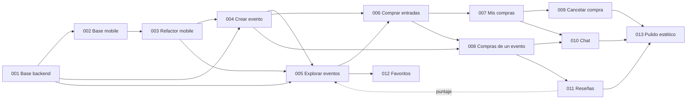

# Backlog — AI Ticket It

Fuente de verdad del **orden** y las **dependencias** entre features (constitución, principio I).
Cada feature se desarrolla en su rama `feature/NNN-slug` con el flujo de Spec Kit.

## Estados

`pendiente` · `spec` · `plan` · `tasks` · `en curso` · `en PR` · `integrada`

## Features

| # | Feature | Casos de uso | Prioridad | Depende de | Estado |
|---|---|---|---|---|---|
| 001 | **Base backend**: monorepo, servidor en capas con middlewares y error handler, repositorios en memoria + datos de ejemplo, recurso Usuarios de referencia, tipos compartidos | — | P0 | — | integrada |
| 002 | **Base mobile**: app Expo con navegación, cliente HTTP y selector de usuario | — | P0 | 001 (contrato de usuarios) | integrada |
| 003 | **Refactor mobile**: organización por feature, piezas base de pantalla (tema, botón, cuatro estados) y cliente HTTP con todos los métodos | — | P0 | 002 | integrada |
| 004 | **Crear evento** con tipos de entrada (precio y cupo) y catálogo de categorías | UC-04 | P1 | 001, 003 | integrada |
| 005 | **Explorar eventos**: búsqueda textual, filtro por categoría, detalle del evento y ordenamiento por precio, fecha y puntaje del organizador | UC-03, UC-11 | P1 | 001, 003, 004 (categorías, detalle del evento y cupo) | integrada |
| 006 | **Comprar entradas**: elegir tipo y cantidad sin superar el cupo, compra `PENDIENTE` y pago simulado → `CONFIRMADA` | UC-12 | P1 | 004 (cerrojo por evento y compra mínima), 005 (detalle del evento) | en PR |
| 007 | **Mis compras**: listado con estado bien diferenciado y días restantes si está confirmada | UC-01 | P1 | 006 | pendiente |
| 008 | **Compras de un evento** (organizador): compras por estado, disponibles por tipo y registrar uso de entrada → `UTILIZADA` | UC-02 | P2 | 004, 006 | pendiente |
| 009 | **Cancelar compra** con reembolso, respetando las reglas de cancelación | UC-07, UC-08 | P2 | 007 | pendiente |
| 010 | **Chat de la compra** entre comprador y organizador | UC-05, UC-06 | P2 | 007, 008 | pendiente |
| 011 | **Reseñas**: puntuar y comentar un evento con entrada utilizada; ver reseñas del organizador; alimenta el puntaje usado en 005 | UC-09, UC-10 | P3 | 008 | pendiente |
| 012 | *(Opcional)* **Favoritos**: guardar eventos favoritos | — (contexto de la consigna) | P4 | 005 | pendiente |
| 013 | **Pulido estético**: sombras/elevación de tarjetas, bordes y transiciones, aplicados de forma global en `tema.ts` y los componentes base (nunca pantalla por pantalla), cuando UC-01 a UC-12 funcionen de punta a punta con sus tests en verde | — | P4 | 004 a 011 | pendiente |

## Cambios de proceso

Cambios del flujo de trabajo que no son features de producto (no siguen Spec Kit).

| Cambio | Rama / PR | Estado |
|---|---|---|
| **Flujo SDD más rápido**: tests focalizados en cada ciclo de TDD (`test:foco`, `test:afectados`) y suite completa al cerrar cada fase; hook `Stop` incremental por paquete (`tsc --incremental`, `eslint --cache`); `/speckit-implement` de a una fase. Constitución v2.3.0 ("Verificación durante el desarrollo") y AGENTS.md. El CI no cambia | `chore/flujo-sdd-rapido` · #9 | integrada |

## Grafo de dependencias

## Oportunidades de paralelismo

- Con el **contrato de usuarios de 001** definido (`specs/001-base-backend/contracts/`), **002**
  puede arrancar antes de que 001 se integre.
- Con **001** integrada, el backend de **004** avanza en paralelo con **002** y **003**; sus
  pantallas se suman cuando 003 se integre.
- **005** va después de **004**: reusa su catálogo de categorías, el detalle público del evento
  (`GET /api/eventos/:eventoId`), el cupo de los tipos y el reloj inyectado. Sus datos de ejemplo
  son los eventos del seed de 004 (con un evento agotado y un tipo gratis).
- **005** ordena por puntaje del organizador antes de que exista **011**: el puntaje sale `null`
  (sin reseñas) y esos eventos van al final. Cuando 011 se integre, el orden se completa solo.
- Con **006** integrada, **007**, **008** y **009** pueden avanzar a la vez; **010** necesita
  las pantallas de 007 y 008, pero su backend puede hacerse contra el contrato antes.

## Decisiones abiertas (a resolver en el `clarify` de cada feature)

- 002: la dirección del servidor debería tomarse por defecto del host de Expo (la IP de la PC),
  con `EXPO_PUBLIC_API_URL` solo para pisarla. Si el servidor no responde al abrir la app,
  conservar el usuario recordado; descartarlo solo si el servidor responde que no existe.
  ¿Versión de Expo SDK alineada con la de Expo Go del celular?
  `shared` exporta TypeScript sin compilar (decisión R2 de 001): Metro lo resuelve, pero
  jest-expo necesita configurar `transformIgnorePatterns` para transformar `@ai-ticket-it/shared`.
- 006: ~~¿cuánto dura una compra `PENDIENTE` sin pagar? ¿expira y libera cupo?~~ Resuelta en su
  clarify: vence a los 15 minutos y libera el cupo; se puede pagar aunque el evento haya empezado.
- 008: ¿desde cuándo puede el organizador registrar el uso de una entrada (solo el día del
  evento)? ¿con qué dato la identifica?
- 009: ¿el reembolso es inmediato (`CANCELADA → REEMBOLSADA` automático) o lo confirma el
  organizador? Plazo **decidido** (revisión del plan de la 006): el de la constitución, hasta que el
  evento empieza o la entrada se usa, sin plazo extra. Una `PENDIENTE` vence a los 15 minutos (006).
- 011: ¿se puede editar o borrar una reseña?

## Deuda técnica

- **Store externo para la sesión**: hoy el estado de la sesión vive en el reducer de
  `SesionProvider` y en el controlador; unificarlo en un store externo (`useSyncExternalStore`)
  sin cambiar `useSesion`, `useClienteApi` ni `useConexion`. No bloquea ninguna feature.
