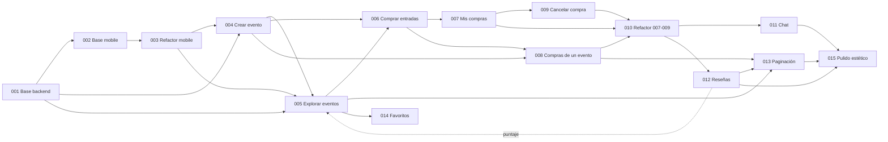

# Backlog — AI Ticket It

Fuente de verdad del **orden** y las **dependencias** entre features (constitución, principio I).
Cada feature se desarrolla en su rama `feature/NNN-slug` con el flujo de Spec Kit.

## Estados

`pendiente` · `spec` · `plan` · `tasks` · `en curso` · `en PR` · `integrada`

## Features

| # | Feature | Casos de uso | Prioridad | Depende de | Estado |
|---|---|---|---|---|---|
| 001 | **Base backend**: monorepo, servidor en capas con middlewares y error handler, repositorios en memoria + datos de ejemplo, recurso Usuarios de referencia, tipos compartidos | — | P0 | — | integrada |
| 002 | **Base mobile**: app Expo con navegación, cliente HTTP y selector de usuario | — | P0 | 001 (contrato de usuarios) | integrada |
| 003 | **Refactor mobile**: organización por feature, piezas base de pantalla (tema, botón, cuatro estados) y cliente HTTP con todos los métodos | — | P0 | 002 | integrada |
| 004 | **Crear evento** con tipos de entrada (precio y cupo) y catálogo de categorías | UC-04 | P1 | 001, 003 | integrada |
| 005 | **Explorar eventos**: búsqueda textual, filtro por categoría, detalle del evento y ordenamiento por precio, fecha y puntaje del organizador | UC-03, UC-11 | P1 | 001, 003, 004 (categorías, detalle del evento y cupo) | integrada |
| 006 | **Comprar entradas**: elegir tipo y cantidad sin superar el cupo, compra `PENDIENTE` y pago simulado → `CONFIRMADA` | UC-12 | P1 | 004 (cerrojo por evento y compra mínima), 005 (detalle del evento) | integrada |
| 007 | **Mis compras**: listado con estado bien diferenciado y días restantes si está confirmada | UC-01 | P1 | 006 | integrada |
| 008 | **Compras de un evento** (organizador): compras por estado, disponibles por tipo y registrar uso de entrada → `UTILIZADA` | UC-02 | P2 | 004, 006 | integrada |
| 009 | **Cancelar compra** con reembolso, respetando las reglas de cancelación | UC-07, UC-08 | P2 | 007 | integrada |
| 010 | **Refactor de 007, 008 y 009**: `Entrada` con estado explícito, invariantes de `Compra` legibles, un solo dueño de `RepositorioCompras`, vistas sin mapeos repetidos y "Registrar ingreso" en componentes; sin cambiar contratos de API ni comportamiento (ver "Alcance de la 010") | — | P2 | 007, 008, 009 | integrada |
| 011 | **Chat de la compra** entre comprador y organizador | UC-05, UC-06 | P2 | 007, 008, 010 | integrada |
| 012 | **Reseñas**: puntuar y comentar un evento con entrada utilizada; ver reseñas del organizador; alimenta el puntaje usado en 005 | UC-09, UC-10 | P3 | 008, 010 | integrada |
| 013 | **Paginación**: páginas de hasta 10 elementos, armadas en el servidor, con un paginador común en la app (hasta 5 botones: primera, última, actual, anterior y siguiente), en el catálogo de Explorar, en Compras del evento y en las reseñas del organizador (el detalle muestra las 3 más recientes con el puntaje y la cantidad reales) | UC-02, UC-03, UC-10 | P3 | 005, 008, 012 | en PR |
| 014 | *(Opcional)* **Favoritos**: guardar eventos favoritos | — (contexto de la consigna) | P4 | 005 | pendiente |
| 015 | **Pulido estético**: sombras/elevación de tarjetas, bordes y transiciones, aplicados de forma global en `tema.ts` y los componentes base (nunca pantalla por pantalla), cuando UC-01 a UC-12 funcionen de punta a punta con sus tests en verde | — | P4 | 004 a 013 | pendiente |

## Cambios de proceso

Cambios del flujo de trabajo que no son features de producto (no siguen Spec Kit).

| Cambio | Rama / PR | Estado |
|---|---|---|
| **Flujo SDD más rápido**: tests focalizados en cada ciclo de TDD (`test:foco`, `test:afectados`) y suite completa al cerrar cada fase; hook `Stop` incremental por paquete (`tsc --incremental`, `eslint --cache`); `/speckit-implement` de a una fase. Constitución v2.3.0 ("Verificación durante el desarrollo") y AGENTS.md. El CI no cambia | `chore/flujo-sdd-rapido` · #9 | integrada |

## Grafo de dependencias

## Oportunidades de paralelismo

- Con el **contrato de usuarios de 001** definido (`specs/001-base-backend/contracts/`), **002**
  puede arrancar antes de que 001 se integre.
- Con **001** integrada, el backend de **004** avanza en paralelo con **002** y **003**; sus
  pantallas se suman cuando 003 se integre.
- **005** va después de **004**: reusa su catálogo de categorías, el detalle público del evento
  (`GET /api/eventos/:eventoId`), el cupo de los tipos y el reloj inyectado. Sus datos de ejemplo
  son los eventos del seed de 004 (con un evento agotado y un tipo gratis).
- **005** ordena por puntaje del organizador antes de que exista **012**: el puntaje sale `null`
  (sin reseñas) y esos eventos van al final. Cuando 012 se integre, el orden se completa solo.
- Con **006** integrada, **007**, **008** y **009** pueden avanzar a la vez.
- **010** (refactor) va antes que **011** y **012** porque toca el modelo de `Compra` y `Entrada`
  que las dos usan (el chat cuelga de una compra; la reseña exige una entrada utilizada). Como no
  cambia contratos, el backend de 011 puede hacerse contra el contrato en paralelo.

## Alcance de la 010 (refactor de 007, 008 y 009)

Sale de `docs/Gemini/analisis-refactor-features-007-008-009.md`, contrastado con el código.
Ordenado por retorno: beneficio (legibilidad y menos lugares que tocar en 011 y 012) contra
esfuerzo (archivos, tests y riesgo). **Regla común**: no cambian los contratos de `shared/`, la
API, la OpenAPI ni el comportamiento visible; la red de seguridad son los tests actuales en verde.

### Se hacen

| # | Cambio | Análisis | Esfuerzo | Beneficio | Por qué |
|---|---|---|---|---|---|
| 1 | `resumenPorTipo` usa `compra.entradasUsadas` en vez de repetir el filtro | 3.3 (1) | muy bajo | bajo | una línea; deja una sola definición de "entrada usada" antes de tocar `Entrada` |
| 2 | `useRegistrarUso` deja de invalidar el evento y el catálogo | 2.5 | muy bajo | bajo | el uso no cambia el cupo y las lecturas ya lo muestran al día; es el único exceso de invalidación confirmado |
| 3 | **`Entrada` con estado explícito** (uso y cancelación con autor y fecha, sin `cambios` ni `estadoEn(compra)`) e **invariantes de `Compra` reescritas**, una por regla (sin `entradasCoherentes` ni la guarda `!cantidadValida \|\| …`) | 2.1 (B), 3.1, fase 2 | alto | alto | el núcleo del problema: `compra.ts` tiene 536 líneas y lo próximo (012 exige una entrada utilizada) pasa por acá |
| 4 | **`compra.reembolso`** como valor derivado único (`pendiente` · `confirmado` · `null`) en lugar de `tieneReembolsoPendiente` y `canceladaDesde` combinados en las vistas | 2.1, fase 2 (3) | bajo (junto con 3) | medio | sigue derivado del historial (sin campo guardado), pero en un solo lugar |
| 5 | `compra.vistas.ts`: `aCompraDelEventoVista` y `aEntradaDelEventoVista` reutilizan piezas comunes en vez de mapear campo por campo | 3.2, fase 3 (3) | bajo-medio | medio | la 009 tuvo que sumar `canceladaDesde` y `reembolso` en tres lugares; es composición interna, sin tocar los tipos de `shared/` |
| 6 | **Un solo dueño de `RepositorioCompras`**: `EntradaService` deja de guardar compras y delega el uso en un método de `CompraService` (con el mismo cerrojo del evento) | 2.2, fase 3 (1) | medio | medio | dos services que escriben el mismo agregado contradicen "cada uno escribe solo su agregado" |
| 7 | `RegistrarIngreso.tsx`: el buscador y el resultado en componentes propios, sin ternarios anidados | 3.5 (1), fase 4 (1) | medio | medio | la pantalla más difícil de leer de la app; sus tests de `tests/pantallas/` la cubren sin cambios |

### Opcionales (solo si sobra tiempo al cerrar la 010)

| Cambio | Análisis | Esfuerzo | Beneficio | Nota |
|---|---|---|---|---|
| Hook `useEnvioUnico` para el `useRef(false)` repetido en `Compra.tsx` y `ComprasDelEvento.tsx` | 3.5 (3) | bajo | bajo | el flag hace falta (el `Alert` responde antes del re-render); solo se deduplica |
| `diasRestantes` sin `split`: una función de fecha de pared en `hora-buenos-aires.ts` | 3.5 (4) | bajo | bajo | la zona horaria tiene que seguir viviendo solo en ese archivo |
| Índice `#codigosUsados` en `CompraRepository` | 3.4 | bajo | muy bajo | con datos en memoria no se nota y agrega estado a mantener en `guardar` |
| Textos de "no se puede usar" sin duplicar entre backend y app | 3.3 (2) | bajo-medio | bajo | no son idénticos (la app agrega la fecha de uso) y exigiría tocar el contrato |

**Resultado (al cerrar la 010):** se hicieron `useEnvioUnico` (en `features/compras`, lo usan
"Tu compra" y "Compras del evento") y `diaDeCalendarioDeBuenosAires` en `hora-buenos-aires.ts`
(lo usa `diasRestantes`). **No** se hicieron el índice `#codigosUsados` ni la deduplicación de los
textos de "no se puede usar", por los motivos de la tabla.

### Se descartan

| Propuesta | Análisis | Motivo |
|---|---|---|
| Achicar el cerrojo de `registrarUso` y `confirmarReembolso` a la compra o al código | 2.3, fase 3 (2) | la constitución ("Operaciones atómicas por evento") lo pide, y cancelar una confirmada (bajo el cerrojo del evento) verifica "sin entradas usadas": con cerrojos distintos, cancelar y usar la misma compra a la vez sería una carrera. El cuello de botella no existe con un proceso y datos en memoria |
| `Entrada` como agregado propio con `RepositorioEntradas` | 2.1 (A), 2.2 | costo muy alto (repositorio, seed, y tope y cupo cruzando dos agregados) para lo que ya resuelve el punto 3 |
| Rediseñar rutas (`/entradas/:codigo` sin evento, reembolso fuera de `/compras`) | 2.4 | rompe contratos, OpenAPI y la app; el 404 ante un código de otro evento es una decisión de la spec 008 |
| Sub-estructuras nuevas en `shared/` (`InfoEvento`, `InfoComprador`…) | fase 3 (3) | cambia los contratos; el punto 5 logra lo mismo dentro del backend |
| Reemplazar la `ronda` de `useRefrescarAlVencer` por `refetchInterval` | 3.5 (2) | pasaría a sondear al servidor; el contador resuelve un caso real (la misma respuesta llega antes del vencimiento). A lo sumo, mejorar el comentario |
| Helpers genéricos de invalidación | 2.5, fase 4 (3) | las invalidaciones por prefijo son deliberadas (el otro usuario puede estar en la caché del dispositivo); el único exceso real es el punto 2 |

## Decisiones abiertas (a resolver en el `clarify` de cada feature)

- 002: la dirección del servidor debería tomarse por defecto del host de Expo (la IP de la PC),
  con `EXPO_PUBLIC_API_URL` solo para pisarla. Si el servidor no responde al abrir la app,
  conservar el usuario recordado; descartarlo solo si el servidor responde que no existe.
  ¿Versión de Expo SDK alineada con la de Expo Go del celular?
  `shared` exporta TypeScript sin compilar (decisión R2 de 001): Metro lo resuelve, pero
  jest-expo necesita configurar `transformIgnorePatterns` para transformar `@ai-ticket-it/shared`.
- 006: ~~¿cuánto dura una compra `PENDIENTE` sin pagar? ¿expira y libera cupo?~~ Resuelta en su
  clarify: vence a los 15 minutos y libera el cupo; se puede pagar aunque el evento haya empezado.
- 008: ~~¿desde cuándo puede el organizador registrar el uso de una entrada (solo el día del
  evento)? ¿con qué dato la identifica?~~ Resuelta en su clarify: dentro de la ventana de uso
  (desde 4 h antes hasta 12 h después del inicio, inclusive), por **entrada**, con el código de 8
  caracteres que solo ve el comprador; con la primera entrada usada la compra pasa a `UTILIZADA`.
- 009: ~~¿el reembolso es inmediato (`CANCELADA → REEMBOLSADA` automático) o lo confirma el
  organizador?~~ Resuelta en su clarify: lo confirma el organizador desde "Compras del evento", sin
  plazo; las compras gratis no se reembolsan. Hoy `POST /compras/:compraId/cancelacion` (006) solo acepta una `PENDIENTE` y la app
  muestra "Cancelar compra" solo en ellas: cancelar una `CONFIRMADA` es de la 009, que también
  tiene que rechazar la cancelación de una entrada ya usada (una `UTILIZADA` nunca se cancela,
  008) y correr bajo el cerrojo del evento, como el uso. Plazo **decidido** (revisión del plan de la 006): el de la constitución, hasta que el
  evento empieza o la entrada se usa, sin plazo extra. Una `PENDIENTE` vence a los 15 minutos (006).
- 012: ¿se puede editar o borrar una reseña?

## Deuda técnica

- **Store externo para la sesión**: hoy el estado de la sesión vive en el reducer de
  `SesionProvider` y en el controlador; unificarlo en un store externo (`useSyncExternalStore`)
  sin cambiar `useSesion`, `useClienteApi` ni `useConexion`. No bloquea ninguna feature.
