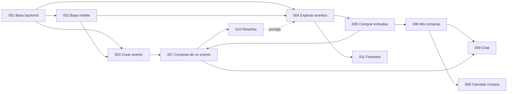

# Backlog — AI Ticket It

Fuente de verdad del **orden** y las **dependencias** entre features (constitución, principio I).
Cada feature se desarrolla en su rama `feature/NNN-slug` con el flujo de Spec Kit.

## Estados

`pendiente` · `spec` · `plan` · `tasks` · `en curso` · `en PR` · `integrada`

## Features

| # | Feature | Casos de uso | Prioridad | Depende de | Estado |
|---|---|---|---|---|---|
| 001 | **Base backend**: monorepo, servidor en capas con middlewares y error handler, Mongo en memoria + seed, recurso Usuarios de referencia, tipos compartidos | — | P0 | — | spec |
| 002 | **Base mobile**: app Expo con navegación, cliente HTTP y selector de usuario | — | P0 | 001 (contrato de usuarios) | pendiente |
| 003 | **Crear evento** con tipos de entrada (precio y cupo) y catálogo de categorías | UC-04 | P1 | 001, 002 | pendiente |
| 004 | **Explorar eventos**: búsqueda textual, filtro por categoría, detalle del evento y ordenamiento por precio, fecha y puntaje del organizador | UC-03, UC-11 | P1 | 001, 002 (usa eventos del seed) | pendiente |
| 005 | **Comprar entradas**: elegir tipo y cantidad sin superar el cupo, compra `PENDIENTE` y pago simulado → `CONFIRMADA` | UC-12 | P1 | 004 (detalle del evento) | pendiente |
| 006 | **Mis compras**: listado con estado bien diferenciado y días restantes si está confirmada | UC-01 | P1 | 005 | pendiente |
| 007 | **Compras de un evento** (organizador): compras por estado, disponibles por tipo y registrar uso de entrada → `UTILIZADA` | UC-02 | P2 | 003, 005 | pendiente |
| 008 | **Cancelar compra** con reembolso, respetando las reglas de cancelación | UC-07, UC-08 | P2 | 006 | pendiente |
| 009 | **Chat de la compra** entre comprador y organizador | UC-05, UC-06 | P2 | 006, 007 | pendiente |
| 010 | **Reseñas**: puntuar y comentar un evento con entrada utilizada; ver reseñas del organizador; alimenta el puntaje usado en 004 | UC-09, UC-10 | P3 | 007 | pendiente |
| 011 | *(Opcional)* **Favoritos**: guardar eventos favoritos | — (contexto de la consigna) | P4 | 004 | pendiente |

## Grafo de dependencias

## Oportunidades de paralelismo

- Con el **contrato de usuarios de 001** definido (`specs/001-base-backend/contracts/`), **002**
  puede arrancar antes de que 001 se integre.
- Con **001** integrada, el backend de **003** y **004** avanza en paralelo con **002**; sus
  pantallas se suman cuando 002 se integre. 004 trabaja con eventos del seed.
- **004** ordena por puntaje del organizador antes de que exista **010**: el puntaje sale `null`
  (sin reseñas) y esos eventos van al final. Cuando 010 se integre, el orden se completa solo.
- Con **005** integrada, **006**, **007** y **008** pueden avanzar a la vez; **009** necesita
  las pantallas de 006 y 007, pero su backend puede hacerse contra el contrato antes.

## Decisiones abiertas (a resolver en el `clarify` de cada feature)

- 002: la dirección del servidor debería tomarse por defecto del host de Expo (la IP de la PC),
  con `EXPO_PUBLIC_API_URL` solo para pisarla. Si el servidor no responde al abrir la app,
  conservar el usuario recordado; descartarlo solo si el servidor responde que no existe.
  ¿Versión de Expo SDK alineada con la de Expo Go del celular?
- 005: ¿cuánto dura una compra `PENDIENTE` sin pagar? ¿expira y libera cupo?
- 007: ¿desde cuándo puede el organizador registrar el uso de una entrada (solo el día del
  evento)? ¿con qué dato la identifica?
- 008: ¿el reembolso es inmediato (`CANCELADA → REEMBOLSADA` automático) o lo confirma el
  organizador? ¿hay plazo mínimo antes del evento?
- 010: ¿se puede editar o borrar una reseña?
