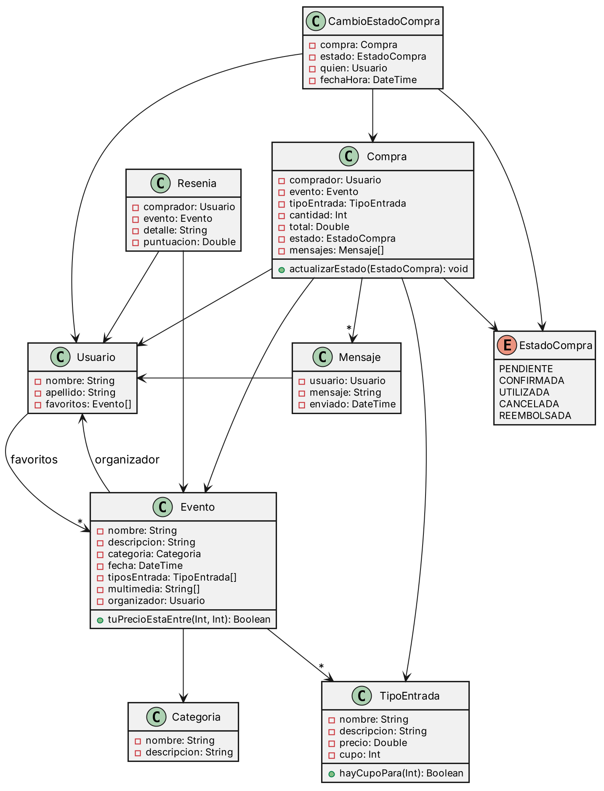

# AI Ticket It — Consigna del TP (resumen operativo)

> Fuente: *DDS UTN — Trabajo Práctico Individual de Desarrollo con IA — 2C 2026*.
> Este archivo es la referencia de producto para las specs. Si algo acá contradice la
> constitución, manda la constitución (y se documenta el porqué).

## Contexto

Plataforma que conecta **organizadores** de eventos (recitales, teatro, festivales,
conferencias, deportes) con **compradores** de entradas.

- Los organizadores publican eventos con descripción, fecha, categoría, material multimedia
  y **tipos de entrada** (ej.: General, Platea, VIP) con precio y cupo; y administran las ventas.
- Los compradores exploran el catálogo, filtran por categoría, buscan por texto, guardan
  favoritos y compran entradas.
- Cada compra atraviesa estados: **pendiente de pago, confirmada, utilizada, cancelada,
  reembolsada**. Comprador y organizador ven el estado actual y actúan según corresponda.
- Cada compra tiene un **chat** simple entre comprador y organizador.
- Terminado el evento, los asistentes **califican** (puntaje + comentario), lo que construye la
  **reputación del organizador**.

## Modelo conceptual tentativo

| Clase | Atributos | Comportamiento |
|---|---|---|
| Usuario | nombre, apellido, favoritos: Evento[] | — |
| Categoria | nombre, descripcion | — |
| Evento | nombre, descripcion, categoria, fecha, tiposEntrada[], multimedia: String[], organizador: Usuario | `tuPrecioEstaEntre(min, max)` |
| TipoEntrada | nombre, descripcion, precio, cupo | `hayCupoPara(cantidad)` |
| Compra | comprador, evento, tipoEntrada, cantidad, total, estado, mensajes[] | `actualizarEstado(estado)` |
| Mensaje | usuario, mensaje, enviado | — |
| CambioEstadoCompra | compra, estado, quien, fechaHora | — |
| Resenia | comprador, evento, detalle, puntuacion | — |
| EstadoCompra (enum) | PENDIENTE, CONFIRMADA, UTILIZADA, CANCELADA, REEMBOLSADA | — |

## Requerimientos técnicos

- **Back-End**: Node + Express.
- **Front-End**: React Native, ejecutándose localmente en un dispositivo móvil.
- **Persistencia en memoria** (resuelto con MongoDB en memoria, ver constitución).
- Herramientas de IA gratuitas; se valora el criterio y la reflexión crítica sobre su uso.

## Casos de uso

| ID | Rol | Historia |
|---|---|---|
| UC-01 | Comprador | Visualizar mis compras, diferenciando claramente el estado y cuántos días faltan para el evento si está **confirmada**. |
| UC-02 | Organizador | Visualizar las compras de un Evento, diferenciando el estado y cuántas entradas quedan disponibles de cada tipo. |
| UC-03 | Comprador | Buscar Eventos por texto o explorarlos por categorías. |
| UC-04 | Organizador | Crear un Evento con distintos tipos de entrada, cada uno con precio y cupo. |
| UC-05 | Comprador | Enviar mensajes en cualquier momento sobre una compra, mediante un chat dentro de la misma. |
| UC-06 | Organizador | Responder mensajes en cualquier momento sobre una compra, mediante el chat de la misma. |
| UC-07 | Comprador | Cancelar una compra para obtener el reembolso si no puedo asistir. |
| UC-08 | Organizador | Que se pueda cancelar una compra solo si no está **utilizada** y el evento aún no se realizó. |
| UC-09 | Organizador | Que, una vez utilizada una entrada, el comprador pueda puntuar el Evento numéricamente y dejar un comentario. |
| UC-10 | Comprador | Ver las reseñas de eventos anteriores en los Eventos de cada organizador. |
| UC-11 | Comprador | Ordenar los Eventos buscados por precio, fecha del evento y puntaje del organizador. |
| UC-12 | Comprador | Comprar sobre un Evento eligiendo un tipo de entrada y una cantidad, sin superar el cupo disponible. |

## Entrega

Video de 5 a 10 minutos con la demo técnica de **un flujo a elección**, explicando:

1. La implementación del flujo en el Back-End.
2. La implementación del flujo en el Front-End.
3. El recorrido completo del flujo en la interfaz.
4. Conclusión: ventajas y desventajas de la IA en el desarrollo, dificultades, aprendizajes y
   valoración del impacto en productividad y calidad.
